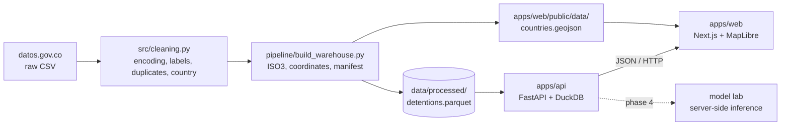
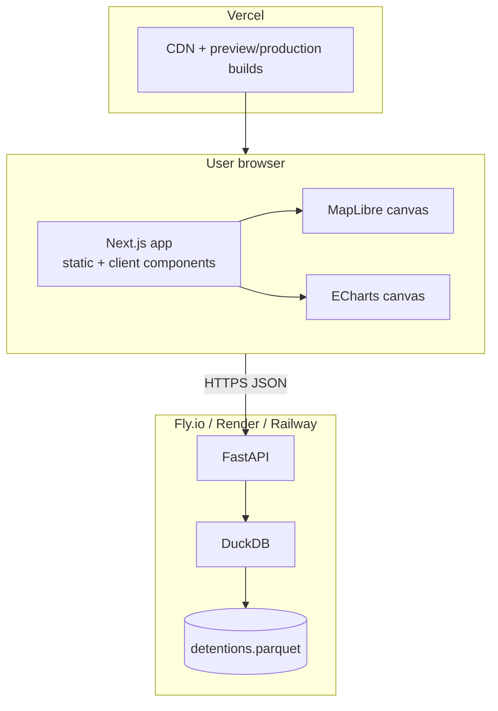
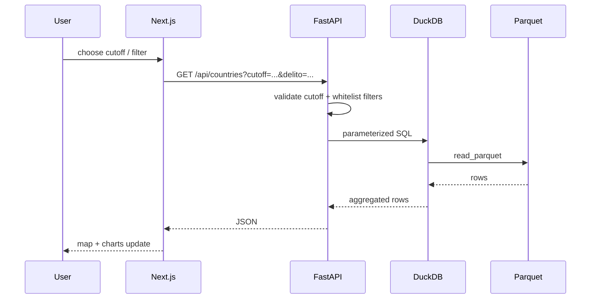
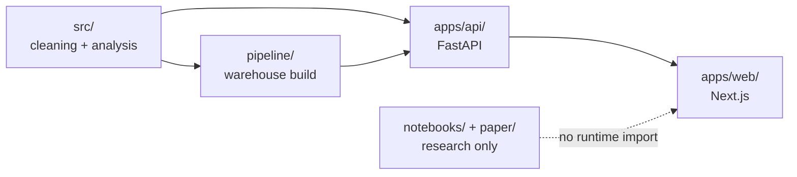

# Architecture

## Goal

Publish an informative, interactive site about Colombians detained abroad, using the
2026 research as the source of truth. The site must answer questions such as:

- How many people are actively detained in each country at a given cutoff?
- How did the stock change between the last cutoff of each year?
- Which crimes, ages, genders and legal situations dominate a country?
- How does 2026 compare with May 2021?
- How reliable are the data and the ordinal model?

## Data flow

The raw CSV and the Parquet file are not committed. The geo asset and the source code are
committed. In production, a scheduled job downloads the newest cutoff, rebuilds the
warehouse, validates it and triggers a backend/frontend deploy.

## Runtime topology

## Query lifecycle

## Repository boundaries

## Why a backend at all?

A pure static site would be enough for fixed aggregates. Live queries were requested, so the
backend exists for three reasons:

1. **Flexible filters without shipping 362k rows to every browser.**
2. **One source of truth for the stock/flow rules.** The API owns the date and aggregation
   semantics.
3. **A safe place to learn server-side modelling.** A model endpoint can be added without
   exposing a binary or a large dependency tree to the frontend.

DuckDB is deliberate: the analytical workload is a single read-only Parquet file, the dataset
is small, and DuckDB gives fast `GROUP BY` queries with zero database operations. If traffic
or write requirements grow, the SQL layer can move to PostgreSQL/Supabase without changing
the HTTP contract.

## Chosen stack

| Layer | Technology | Reason |
|---|---|---|
| Warehouse | Parquet built with pandas | Portable, columnar, easy to regenerate |
| Query engine | DuckDB | Serverless OLAP over Parquet; no DB server |
| API | FastAPI + Pydantic | Typed, self-documenting, Python reuse |
| Frontend | Next.js App Router + TypeScript | Static pages, Vercel-native, good UX |
| Map | MapLibre GL JS | Open source, no token, vector GeoJSON |
| Charts | Apache ECharts | Rich tooltips, bars, diverging comparison |
| Deploy API | Docker on Fly.io / Render / Railway | Python and data fit naturally |
| Deploy web | Vercel | Preview deploys and CDN |

## Boundaries

- `src/` must not import web code.
- `apps/api/` may import `src/` and read `data/processed/`.
- `apps/web/` only talks HTTP and reads static geo assets. It must not import Python.
- `notebooks/` are research artifacts. New reusable logic goes to `src/` or `pipeline/`.
- `paper/` and `reports/` are deliverables, not runtime dependencies.

## Environments

| Environment | API URL | Data |
|---|---|---|
| Local | `http://localhost:8000` | `data/processed/detentions.parquet` |
| Preview | Render/Fly URL | same contract, rebuilt from the newest cutoff |
| Production | public API domain | same contract |

The frontend reads `NEXT_PUBLIC_API_URL`. The API reads `DETENTIONS_PARQUET`,
`MANIFEST_PATH`, `MODEL_DIR`, `ALLOWED_ORIGINS` and `APP_ENV`.

## Non-goals for v1

- User accounts, comments or forms.
- Individual case tracking. The source has no individual identifier.
- Causal claims. The data is observational and aggregated.
- A public prediction service. See [`model-lab.md`](model-lab.md).
