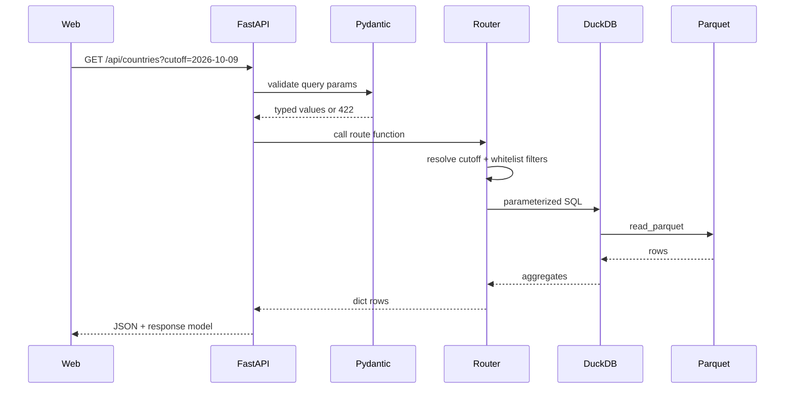

# Backend module

```text
apps/api/
├── app/
│   ├── main.py           FastAPI app, CORS, lifespan, routers
│   ├── config.py         environment-driven paths
│   ├── db.py             DuckDB connection and query helpers
│   ├── schemas.py        Pydantic response models
│   └── routers/
│       ├── explore.py    meta, countries, breakdowns, trend, compare, filters
│       └── model.py      research metrics (and later the model lab)
├── tests/
├── requirements.txt
└── Dockerfile
```

## Request lifecycle



## Design

- The API is read-only. It opens one DuckDB in-memory connection and registers a view over
  `data/processed/detentions.parquet`.
- Every request is a SQL aggregation. No pandas in the request path.
- Filter values are validated against a whitelist and bound as SQL parameters.
- The response models are stable; the frontend should not depend on DuckDB identifiers.
- `src/cleaning.py` is used by the pipeline, not by every API request.

## Why DuckDB

- A single Parquet file of ~362k rows is faster to scan than to load into a client.
- It supports `group by`, `sum`, `quantile` and date filters with no infrastructure.
- It is embedded in the API process; there is no database to operate.
- It is a good learning step before PostgreSQL. The SQL is conventional.

## Local run

```bash
# from the repository root
python3 -m venv .venv
source .venv/bin/activate
pip install -r requirements.txt
pip install -r apps/api/requirements.txt

make download
make warehouse

uvicorn apps.api.app.main:app --reload --port 8000
```

Open <http://localhost:8000/docs>.

## Environment

| Variable | Default | Purpose |
|---|---|---|
| `DETENTIONS_PARQUET` | `data/processed/detentions.parquet` | Queryable warehouse |
| `MANIFEST_PATH` | `data/processed/manifest.json` | Provenance metadata |
| `MODEL_DIR` | `artifacts/models` | Future model binaries |
| `ALLOWED_ORIGINS` | `http://localhost:3000` | Comma-separated CORS origins |
| `APP_ENV` | `development` | Enables docs and verbose errors |

## Testing

```bash
.venv/bin/python -m pytest apps/api/tests -q
```

Tests build a tiny Parquet fixture, override the settings and exercise the routes without
touching the real dataset.

## Deployment

Build and run with Docker:

```bash
docker build -f apps/api/Dockerfile -t detenidos-api .
docker run --rm -p 8000:8000 \
  -e ALLOWED_ORIGINS=https://your-site.vercel.app \
  -v "$PWD/data:/app/data:ro" \
  detenidos-api
```

For Fly.io/Render/Railway, set the environment variables and mount or bake the parquet. A
production update is: download → `make warehouse` → validate manifest → deploy. Never
publish a cutoff without updating `config/params.json`.

## TODO

- [ ] Rate limiting for public deployment.
- [ ] Response caching (`Cache-Control`, ETag by cutoff).
- [ ] Structured request logging.
- [ ] Optional PostgreSQL adapter if writes/admin are added.
- [ ] Model inference endpoint in phase 4.
