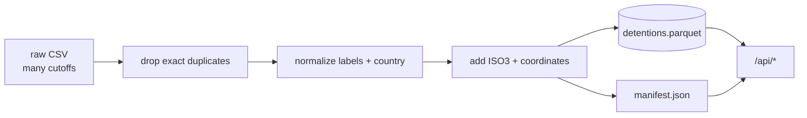

# Data contract

## Source

Datos Abiertos Colombia, Cancillería de Colombia:

<https://www.datos.gov.co/Estad-sticas-Nacionales/Colombianos-detenidos-en-el-exterior/e97j-vuf7>

The raw file is a sequence of publication cutoffs. It is not a unique list of people.



## Warehouse file

Generated by `pipeline/build_warehouse.py`:

```text
data/processed/detentions.parquet
```

One row per cleaned source record. `CANTIDAD` is the number of active detained people in
that record. **Do not sum across publication dates.**

| Column | Type | Meaning |
|---|---|---|
| `fecha_publicacion` | date | Publication cutoff |
| `pais` | string | Country recovered from consulate, then `PAIS PRISIÓN` |
| `pais_iso3` | string | ISO-3166 alpha-3 code, when known |
| `consulado` | string | Consulate label from the source |
| `delito` | string | Normalized crime category |
| `edad` | string | Normalized age group |
| `genero` | string | Normalized gender |
| `situacion` | string | Normalized legal situation |
| `cantidad` | integer | Active detained people in the record |
| `latitud` | double | Country/consulate latitude |
| `longitud` | double | Country/consulate longitude |
| `anio` | integer | Publication year |

The `DESCONOCIDO` value is a real category. Do not silently drop it; show it as a data
quality signal.

## Manifest

```text
data/processed/manifest.json
```

Contains the cutoff date, source file, row counts, duplicate count, date range, checksum,
missing-country share and generation timestamp. The API exposes it as `/api/meta`.

## HTTP API

Base path: `/api`. All dates use `YYYY-MM-DD`. Unknown dates return `422`; invalid
dimensions return `422`.

### `GET /api/health`

Liveness probe. Returns `{"status": "ok", "cutoff": "..."}`.

### `GET /api/meta`

Returns manifest plus the list of cutoffs and the current stock.

### `GET /api/cutoffs`

Returns `{"cutoffs": [...], "latest": "..."}`.

### `GET /api/countries`

Query params:

- `cutoff` (optional, defaults to latest)
- `pais`, `delito`, `edad`, `genero`, `situacion` (optional filters)
- `limit` (default 250)

Returns one row per country with `pais`, `pais_iso3`, `cantidad`, `participacion`,
`latitud`, `longitud`.

### `GET /api/breakdown/{dimension}`

`dimension` is one of `pais`, `delito`, `edad`, `genero`, `situacion`, `consulado`.
Same filters as `/api/countries`. Returns `[{ "valor": "...", "cantidad": n }]`.

### `GET /api/trend`

Last cutoff of each year, optionally filtered by `pais`. Returns
`[{ "anio": 2018, "fecha": "2018-09-17", "cantidad": 23284 }]`.

### `GET /api/compare`

Query params `base=2021-05-01`, `target=2026-10-09`, `limit=250`. Returns country-level
stock in both cutoffs, absolute change and percentage change.

### `GET /api/filters`

Returns the distinct values and counts for each filter at a cutoff. Used to populate the
dashboard controls.

### `GET /api/model/metrics`

Returns the 2026 ordinal and Random Forest metrics when the private
`outputs/tables/metricas_modelos.csv` artifact exists; otherwise `404`.
Returns `404` if the research artifacts are missing.

### `POST /api/model/predict` (phase 4, lab only)

Planned contract:

```json
{
  "pais": "ESPAÑA",
  "delito": "NARCOTRÁFICO",
  "edad": "ADULTO",
  "genero": "MASCULINO"
}
```

Response: ordered probabilities for `EN INVESTIGACIÓN`, `EN JUICIO`, `CONDENADO`, plus a
model version and an explicit `advertencia` string. This endpoint must never be presented as
a real risk assessment about a person.

## Caching

Successful `GET` responses under `/api/` include:

- `ETag`: dataset checksum + resource path/query;
- `Cache-Control: public, max-age=300, stale-while-revalidate=600`.

Send `If-None-Match` with the previous ETag to receive `304 Not Modified`. `/api/health` is
excluded from caching. A new warehouse changes the checksum and therefore the ETag.

## Invariants

1. A response never mixes cutoffs.
2. `participacion` is computed within the filtered population.
3. Country totals exclude `DESCONOCIDO` from the map but the API still reports the total.
4. `pais_iso3` may be `null`; the frontend must handle it.
5. Sorting is always by `cantidad` descending, then label.
