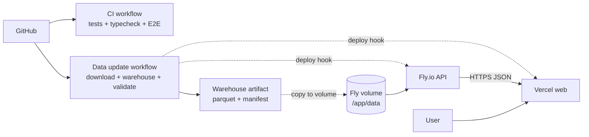

# Deployment and rollback

This document describes the production topology, the deployment steps, the data update
workflow and how to roll back safely. The repository contains the configuration and CI
scaffolding; creating accounts, volumes and secrets is a manual step.



## Components

| Component | Host | What it needs |
|---|---|---|
| `apps/api` | Fly.io (or Render/Railway) | Docker image, `detentions.parquet`, manifest, `ALLOWED_ORIGINS` |
| `apps/web` | Vercel | `NEXT_PUBLIC_API_URL`, static GeoJSON |
| Data | GitHub Actions artifact + storage | Raw CSV is downloaded at build time, never committed |

The API is stateless except for the mounted warehouse. The web app is static plus client-side
fetches.

## 1. Deploy the API to Fly.io

Requirements: a Fly.io account, `flyctl`, and a volume for the Parquet.

```bash
# from the repository root
fly auth login
fly launch --no-deploy --copy-config --name colombianos-detenidos-api
fly volumes create detenidos_data --region mia --size 1
fly secrets set ALLOWED_ORIGINS="https://your-site.vercel.app"
fly deploy
```

`fly.toml` already points to `apps/api/Dockerfile`, exposes port `8000`, mounts the volume at
`/app/data`, and checks `GET /api/health` every 30 seconds.

### Put the warehouse on the volume

The image does not contain the data. After `make warehouse` (or after downloading the CI
artifact), copy both files to `/app/data/processed/`:

```bash
fly ssh console -a colombianos-detenidos-api -C "mkdir -p /app/data/processed"
fly ssh sftp shell -a colombianos-detenidos-api
# inside the sftp shell:
put data/processed/detentions.parquet /app/data/processed/detentions.parquet
put data/processed/manifest.json /app/data/processed/manifest.json
exit
fly apps restart colombianos-detenidos-api
```

Verify:

```bash
curl https://colombianos-detenidos-api.fly.dev/api/health
curl -sD - -o /dev/null "https://colombianos-detenidos-api.fly.dev/api/countries?limit=3" \
  | grep -iE "etag|cache-control"
```

The second command should show `ETag` and `Cache-Control` headers.

### Environment variables

| Variable | Value |
|---|---|
| `ALLOWED_ORIGINS` | Vercel production domain (comma-separated for previews) |
| `DETENTIONS_PARQUET` | `/app/data/processed/detentions.parquet` |
| `MANIFEST_PATH` | `/app/data/processed/manifest.json` |
| `APP_ENV` | `production` |

Never commit `ALLOWED_ORIGINS` secrets or tokens. Use `fly secrets set`.

## 2. Deploy the web app to Vercel

1. Push the repository to GitHub.
2. Import the project in Vercel.
3. Set **Root Directory** to `apps/web`.
4. Add `NEXT_PUBLIC_API_URL=https://colombianos-detenidos-api.fly.dev`.
5. Deploy.

Vercel creates a preview deployment for every pull request. For previews that call the API,
add the preview domain pattern to `ALLOWED_ORIGINS` or use a wildcard domain that your
security policy allows. Avoid `*` in production.

## 3. CI and scheduled data updates

| Workflow | Trigger | What it does |
|---|---|---|
| `.github/workflows/ci.yml` | push / PR | Python tests, TypeScript typecheck, Playwright E2E |
| `.github/workflows/data-update.yml` | monthly + manual | Download, build, validate, upload artifact, optional deploy hooks |

The data workflow uploads `warehouse-<cutoff>` for 90 days. It does **not** commit the
Parquet. To publish a new cutoff:

1. Run the workflow manually or wait for the schedule.
2. Check the job summary and the artifact.
3. Copy the artifact to the Fly volume (see above).
4. Restart the API.
5. Trigger the Vercel deploy (or let the deploy hook do it).

### Optional deploy hooks

Set these repository secrets to make the workflow trigger deployments automatically:

| Secret | Purpose |
|---|---|
| `API_DEPLOY_HOOK` | URL that redeploys/restarts the API after validation |
| `VERCEL_DEPLOY_HOOK` | Vercel deploy hook for the frontend |

The workflow only calls a hook when the secret is non-empty. A hook should pull the new
warehouse (or trigger the process that copies it); an HTTP POST alone does not move files.

### Stale config guard

`pipeline/validate_warehouse.py` fails when `config/params.json` `report_cutoff` is older than
the downloaded data. Update `report_cutoff`, `train_date` and `test_date` when a new cutoff
arrives, then re-run the workflow. For a one-off inspection, run:

```bash
python pipeline/validate_warehouse.py --allow-stale-config
```

## 4. Rollback

### Web

Vercel keeps every deployment. Use **Deployments → previous deployment → Promote to
Production** (or Instant Rollback). This restores the previous static build and API URL
configuration.

### API

```bash
fly releases
fly deploy --image <previous-image-ref>
```

Alternatively, restore the previous machine image from the Fly dashboard. If the problem is
data, continue with the data rollback.

### Data

Each build produces a `manifest.json` with `corte_actual`, `source_sha256` and counts. Keep the
last few `warehouse-<cutoff>` artifacts (the workflow retains 90 days). To roll back:

1. Download the previous artifact.
2. Copy its `detentions.parquet` and `manifest.json` to `/app/data/processed/` on the volume.
3. `fly apps restart colombianos-detenidos-api`.
4. Verify `/api/meta` shows the expected cutoff and `/api/health` is `200`.

Because the ETag includes the dataset checksum, clients automatically receive fresh content
after a rollback instead of a stale `304`.

### Rollback order

1. Roll back the API/data first.
2. Then roll back the web app if the contract changed.
3. Verify `/api/meta`, `/api/countries`, the map and the cutoff badge.

## 5. Operational checklist

- [ ] `/api/health` returns `200` and the expected cutoff.
- [ ] `ALLOWED_ORIGINS` matches the deployed web domain.
- [ ] The API response includes `ETag` and `Cache-Control`.
- [ ] The web build has `NEXT_PUBLIC_API_URL` set.
- [ ] The warehouse artifact and manifest were validated.
- [ ] The previous artifact is kept for rollback.
- [ ] The cutoff badge in the UI matches `/api/meta`.
