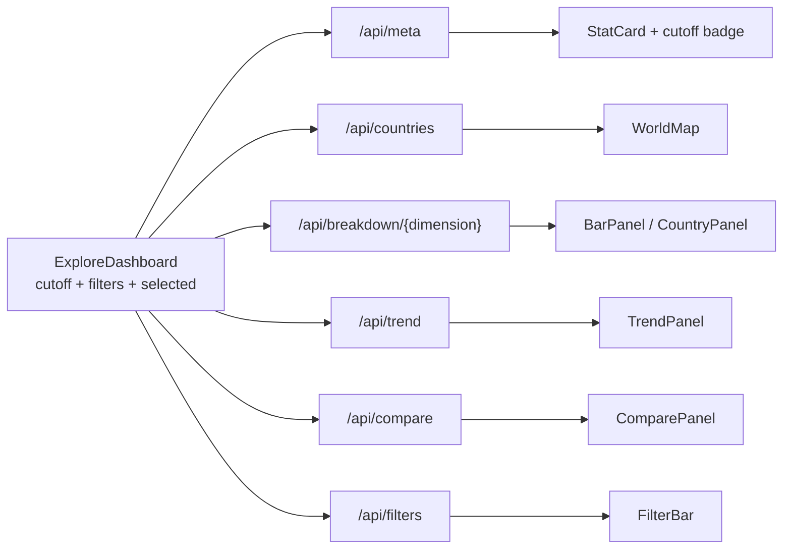
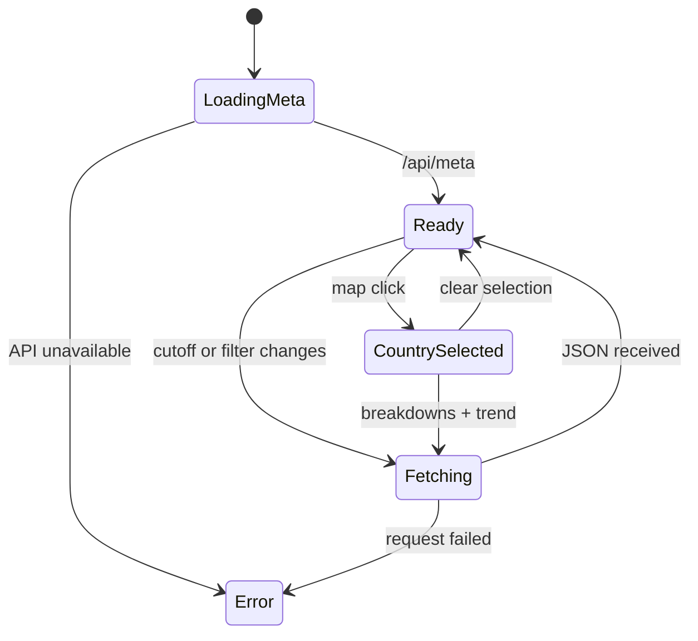

# Frontend module

```text
apps/web/
├── app/
│   ├── layout.tsx        shell, metadata, fonts and navigation
│   ├── page.tsx          explore dashboard
│   ├── methodology/      stock vs flow, consulate recovery, limitations
│   └── model/            research metrics and model lab placeholder
├── components/
│   ├── ExploreDashboard.tsx  owns cutoff, filters and selected country
│   ├── FilterBar.tsx         cutoff + categorical controls
│   ├── WorldMap.tsx          MapLibre choropleth
│   ├── Chart.tsx             ECharts lifecycle wrapper
│   ├── BarPanel.tsx          horizontal bars
│   ├── TrendPanel.tsx        stock at the last cutoff of each year
│   ├── ComparePanel.tsx      2021 vs 2026 diverging chart
│   ├── CountryPanel.tsx      country profile
│   ├── StatCard.tsx          headline indicators
│   └── ModelPanel.tsx        metrics and limitations
├── lib/
│   ├── api.ts                typed API client
│   ├── format.ts             numbers and percentages in es-CO
│   └── model-reference.ts    static fallback metrics
├── public/data/countries.geojson
└── package.json
```

## UX rules

- Spanish (`es-CO`) is the interface language.
- The cutoff is always visible. There is no ambiguous "latest" label without a date.
- The map is the primary control: clicking a country opens its profile and applies filters.
- Mobile first: filters collapse into a panel, charts stack vertically.
- The site must remain useful if the API is down: show a clear error, not empty cards.
- Never present the ordinal model as a prediction about a real person.

## Data flow



The client is deliberately thin. It does not compute stock semantics; the API does.

## Component state flow



## Map

- MapLibre GL JS with a blank background and a committed GeoJSON.
- Choropleth fill uses quantile bins over positive country counts.
- `DESCONOCIDO` is excluded from the country layer and reported separately.
- Clicking a feature selects the country; clicking the background clears it.
- No external basemap token is required. This keeps previews deterministic.

## Local run

```bash
cd apps/web
pnpm install
NEXT_PUBLIC_API_URL=http://localhost:8000 pnpm dev
```

Open <http://localhost:3000>.

## Production

- Vercel project root: `apps/web`.
- Environment: `NEXT_PUBLIC_API_URL=https://api.example.org`.
- The GeoJSON is static and cacheable; the API responses depend on the cutoff.

## TODO

- [ ] URL-synced filters (`?cutoff=...&pais=...`) for shareable views.
- [ ] Country profile page with a static, indexable route.
- [ ] Download filtered CSV.
- [ ] Accessibility audit and keyboard navigation on the map.
- [ ] English translation.
- [ ] Model lab interaction (phase 4).
