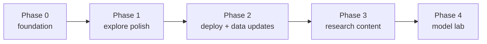

# Roadmap and module TODO

The project is built in steps. Each step must be independently runnable and committed.

## Phase 0 — Foundation

- [x] Document architecture, data contract, research decisions and model lab.
- [x] Add `apps/`, `pipeline/` and `docs/` boundaries.
- [x] Warehouse build script with ISO3/coordinates and manifest.
- [x] FastAPI live-query backend over DuckDB.
- [x] Next.js dashboard with MapLibre choropleth and live filters.
- [x] Methodology page and model metrics page.
- [x] Make targets, environment examples and tests.
- [x] Harden `.gitignore` for Python, Node, data, secrets and build outputs.

## Phase 1 — Explore v1 polish

- [x] Add URL-synced filters (`?cutoff=...&pais=...`) using native search params.
- [x] Add country profile drawer with consulates and legal-situation breakdown.
- [x] Add comparison chart with a diverging bar and percentage labels.
- [x] Show data-quality panel (unknown age, unknown crime, imputed country).
- [x] Replace placeholder chart styling with a shared theme (`lib/chart-theme.ts`).
- [x] Add empty, loading and error states for every panel.
- [x] Add Playwright smoke test: map loads, URL country and filter sync.

## Phase 2 — Deployment and data updates (groundwork ready)

- [x] GitHub Action: monthly download, warehouse build, manifest validation.
- [x] CI workflow for unit/API tests, typecheck and Playwright (see [`testing.md`](testing.md)).
- [ ] Deploy API to Fly.io or Render with Docker (requires account; config is in `fly.toml`).
- [x] Free static demo export + adapter (`make web-data`, `NEXT_PUBLIC_STATIC_DEMO`).
- [ ] Deploy web to Vercel as a static demo or connected to the live API (requires account).
- [x] Add `/api/health` uptime check and deploy hook support.
- [x] Cache API responses with `ETag` keyed by dataset checksum.
- [x] Document rollback to a previous warehouse version (see [`deployment.md`](deployment.md)).

## Phase 3 — Research and content

- [ ] Add downloadable filtered CSV.
- [ ] Add static country pages for SEO.
- [ ] Add Spanish/English copy review.
- [ ] Add citations and a permanent data DOI/version.
- [ ] Add accessibility audit (contrast, keyboard, screen reader labels).

## Phase 4 — Model lab (server-side ML)

- [ ] Add `predict_proba` to `OrdinalLogisticRegression`.
- [ ] Add `pipeline/train_model.py` with versioned metadata.
- [ ] Load model and encoder in FastAPI at startup.
- [ ] Implement `POST /api/model/predict` with strict validation.
- [ ] Add tests with fixed inputs and expected probability ranges.
- [ ] Build the lab UI with a prominent "not a risk assessment" warning.
- [ ] Add request caching and latency metrics.
- [ ] Optional: compare ordinal vs Random Forest in the lab.

## Module backlog

### `src/`

- [ ] Keep `cleaning.py` importable without pandas warnings on Python 3.14.
- [ ] Extract `TARGET_ORDER` and feature list to a shared module used by pipeline and API.
- [ ] Add a `__main__` entry point for the analysis.

### `pipeline/`

- [ ] Add `--validate-only` and fail on invariant violations.
- [ ] Add a checksum of the raw file to the manifest.
- [ ] Add `train_model.py` (phase 4).
- [ ] Add a tiny sample fixture for CI.

### `apps/api/`

- [ ] Rate limiting and request IDs.
- [ ] `ETag`/`Cache-Control` for aggregate endpoints.
- [ ] Structured logging.
- [ ] Optional PostgreSQL adapter.
- [ ] Model endpoint (phase 4).

### `apps/web/`

- [x] URL state and shareable views.
- [ ] Country detail route.
- [ ] Download controls.
- [ ] i18n.
- [ ] Model lab UI.

### Repo

- [ ] Move `src/` to `pipeline/` when the API no longer imports it directly.
- [ ] Add pre-commit (ruff, prettier, eslint).
- [ ] Add a CI workflow for Python tests, typecheck and E2E (see [`testing.md`](testing.md)).
