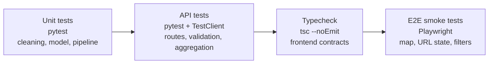

# Testing strategy

The project uses four test layers. They answer different questions and should stay
independent: a failure in one layer should point to a specific module.



## What each layer covers

| Layer | Command | Covers | Does not cover |
|---|---|---|---|
| Unit | `make test` | Cleaning, normalization, duplicate removal, ordinal model, ISO3 lookup | HTTP, browser, real dataset |
| API | `make test-api` | Route responses, cutoff validation, dimension whitelist, filtering | Real warehouse contents |
| Typecheck | `make test-web` | TypeScript contracts between components and the API client | Runtime behavior |
| E2E | `make test-e2e` | Page render, MapLibre canvas, URL country selection, filter → URL sync | Real API, real data, visual regression |

`make test` runs the unit and API suites together.

## Python tests

```bash
make install
make test
```

The suites are:

- `tests/test_cleaning.py` — encoding repair, label normalization, country recovery,
  duplicate removal, snapshots.
- `tests/test_model.py` — the ordinal classifier fits and predicts ordered classes.
- `pipeline/tests/test_warehouse.py` — ISO3 lookup and unknown-country handling.
- `apps/api/tests/test_api.py` — a temporary Parquet fixture is loaded into a test app;
  no real dataset is needed.

The API tests override the app settings and use FastAPI's `TestClient`. They do not touch
`data/processed/`.

## Frontend typecheck

```bash
make test-web
# equivalent to: cd apps/web && pnpm typecheck
```

This catches mismatches such as a renamed API field or a missing prop. It requires the
Next.js dependencies and, on a fresh clone, the generated `.next` types. Run
`pnpm build` once if TypeScript cannot find `routes.d.ts`.

## End-to-end smoke tests

```bash
cd apps/web
pnpm exec playwright install chromium   # once per machine
pnpm test:e2e
```

Or from the repository root:

```bash
make test-e2e
```

`apps/web/playwright.config.ts` starts a **fresh production build** on port `3100`. It does
not reuse your development server, so the test is deterministic even if `make web` is
already running on `3000`.

`apps/web/e2e/mock-api.ts` intercepts every `/api/**` request, so Playwright needs neither
the FastAPI service nor the Parquet warehouse. The tests are:

1. Dashboard and MapLibre canvas render, with the mocked total.
2. `?pais=ESPAÑA` selects the country profile.
3. Choosing a crime filter writes `delito=` to the URL.

### Debugging

```bash
cd apps/web
pnpm exec playwright test --headed       # see the browser
pnpm exec playwright test --ui           # interactive runner
pnpm exec playwright test --debug        # step through
```

Failed tests write traces to `test-results/`, which is ignored by Git. Use
`pnpm exec playwright show-trace test-results/<test>/trace.zip` to inspect one.

## What is intentionally not covered yet

- **Real API contract in E2E.** The mock keeps CI independent from the data. Add one
  integration test against a real API when the deployment exists.
- **Visual regression.** Map colors and chart layout change with data; screenshots would be
  brittle. Add visual tests only after the design stabilizes.
- **Accessibility.** Keyboard navigation, focus order and contrast still need an audit.
- **Mobile viewport.** Add Playwright projects for a phone viewport in phase 3.
- **Model lab.** Covered when phase 4 adds the inference endpoint.

## CI recommendation

```bash
make test          # unit + API
make test-web      # typecheck
make test-e2e      # production build + browser smoke tests
```

For GitHub Actions, install pnpm and Chromium before the E2E step:

```yaml
- run: pnpm install --frozen-lockfile
  working-directory: apps/web
- run: pnpm exec playwright install --with-deps chromium
  working-directory: apps/web
- run: make test-e2e
```

Do not run `make warehouse` in CI unless the raw data is available. The unit and API suites
use fixtures on purpose.
